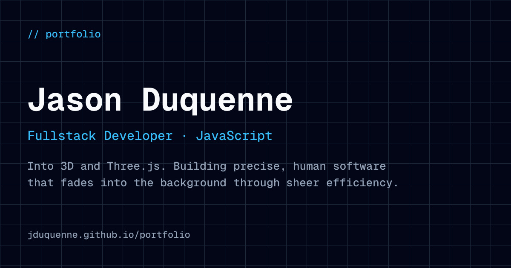

# Portfolio



My personal portfolio, live at **[jduquenne.github.io/portfolio](https://jduquenne.github.io/portfolio/)**, in French and English.

It is built as a small demonstration of how I work: precise, fast, accessible, and designed in two distinct experiences rather than one responsive page.

## Two experiences

The breakpoint is `lg` (1024px). Below it and above it, the page is not the same.

- **Desktop: a bento dashboard.** A sidebar with identity and contact, then the experience, the projects and the passions. Hovering a project card plays a short clip of the project, and `Ctrl K` opens a command palette (jump to a section, switch language, copy my email, play a game).
- **Mobile: a narrative feed.** One full-screen section at a time with scroll snapping, a bottom navigation that follows where you are, and a Lights Out mini-game.
- **`/cv`: a printed sheet.** The same data as an A4 CV, generated as a PDF at build time, in both languages.

## What is worth a look

- **Static export.** No server at runtime: everything is resolved at build time and served from GitHub Pages. A scheduled workflow rebuilds it every day to refresh the data.
- **Live GitHub data.** The Projects section lists my most recently pushed public repositories, read at build time with a single GraphQL request.
- **Project previews on hover.** Each card shows a still image; a muted H.264 clip is only requested after the card has been hovered or focused for a moment. Nothing heavy is downloaded at rest, and phones only get the still.
- **Accessible by default.** Visible focus, a skip link, text contrast above WCAG AA, 40px touch targets on the main mobile controls, reduced-motion support, and a plain-text version of the page for visitors and crawlers without JavaScript.
- **Bilingual.** French by default, English alongside; all interface text lives in `messages/`, all content in `src/lib/data/cv.ts`.

## Stack

| | |
|---|---|
| Framework | Next.js 16 (App Router), static export |
| Language | TypeScript, strict |
| Styling | Tailwind CSS v4, on an 8px grid |
| Motion | Framer Motion |
| i18n | next-intl (`fr` default, `en`) |
| Icons and fonts | Lucide, Geist Mono and Inter via `next/font` |
| CV | `@react-pdf/renderer`, run at build time only (a dev dependency) |

## Run it locally

Node 20 or later.

```bash
npm install
npm run dev        # http://localhost:3000
```

The Projects section reads GitHub at build time. Create a `.env.local` with:

```bash
GH_USERNAME=your-github-username
GH_TOKEN=a-fine-grained-token   # optional, see docs/development.md
```

Without a token the site still builds: it falls back to the public REST API and the repository counters and Pages links are left out.

```bash
npm run lint       # ESLint
npm run build      # CV PDFs, social image, then the static export into out/
```

## Deployment

`.github/workflows/deploy.yml` builds and publishes to GitHub Pages under `/portfolio` on every push to `master`, on demand, and every day at 05:00 UTC.

## Documentation

Everything about how the project is organised lives next to the code:

- [`AGENTS.md`](AGENTS.md): the entry point, with the rules the project follows.
- [`docs/architecture.md`](docs/architecture.md): structure, the two experiences, data flow.
- [`docs/development.md`](docs/development.md): setup, commands, GitHub data, CV pipeline, adding a project preview.
- [`docs/ui-design.md`](docs/ui-design.md): grid, palette, typography, motion, accessibility.
- [`docs/decisions.md`](docs/decisions.md): why things are the way they are.
